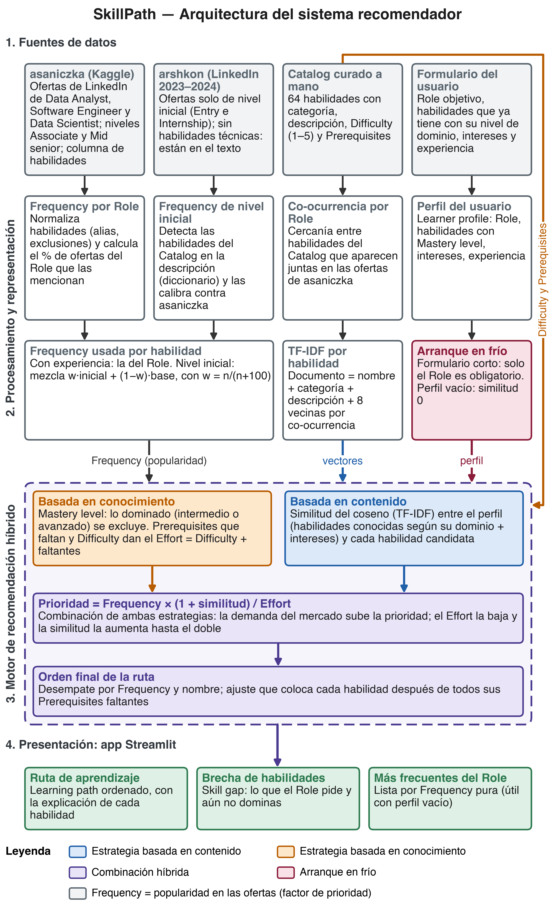
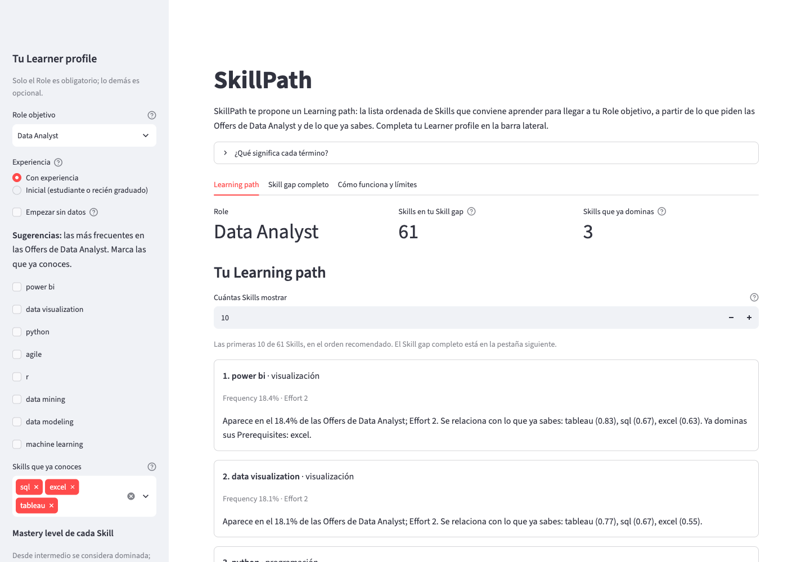
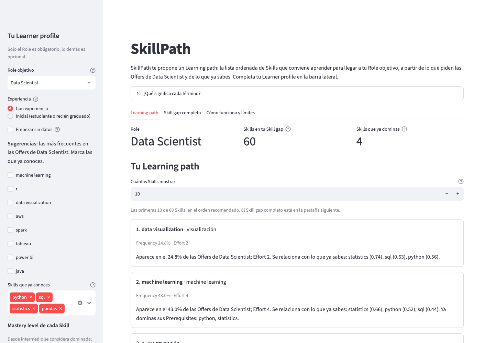

# SkillPath — Sistema recomendador de rutas de aprendizaje de habilidades profesionales basado en ofertas laborales y conocimientos previos

**Taller de Sistemas Recomendadores 2026-1 — Documento final**

**Grupo 7:** Gabriel Escobar, Oscar Ramirez

**Repositorio (privado):** https://github.com/OscarMURA/skillpath-skills-recommender

**Cuaderno de Jupyter:** `notebooks/skillpath.ipynb` (versionado con las salidas ya ejecutadas).

**Aplicación web:** `app/streamlit_app.py`; se ejecuta con `pip install -e ".[dev]"` y `streamlit run app/streamlit_app.py` (Python 3.12 o superior).

---

> **Objetivo del sistema.** Recomendar a cada usuario una ruta de aprendizaje ordenada de las habilidades que le faltan para su perfil profesional objetivo, priorizando las de mayor valor en el mercado laboral que pueda adquirir con menor esfuerzo dados sus conocimientos actuales.

Este objetivo es el hilo conductor: la Parte 1 lo justifica y elige estrategias, la Parte 2 lo diseña e implementa, y la Parte 3 analiza qué sesgos le impiden cumplirlo y cómo corregirlos. Seguimos la numeración del enunciado. Cada cifra indica su fuente (archivo de `reports/`, `catalog/` o `docs/`, o ejecución con su fecha). El Anexo A relaciona el vocabulario con los términos del repositorio y el Anexo B lista los documentos de apoyo.

---

# PARTE 1. Propuesta del sistema recomendador

## 1.1. Contexto de aplicación

Los estudiantes y profesionales del sector tecnológico necesitan desarrollar competencias que les permitan acceder a mejores oportunidades laborales. Sin embargo, identificar qué habilidades deberían aprender y en qué orden puede resultar complicado debido a la variedad de tecnologías solicitadas por las empresas y las diferencias entre los conocimientos previos de cada persona.

El proyecto propone un sistema que recomiende rutas de aprendizaje personalizadas, priorizando las habilidades que aporten mayor valor profesional y que el usuario pueda adquirir con menor esfuerzo, aprovechando sus conocimientos actuales. Se enfoca en tres perfiles: Data Analyst, Software Engineer y Data Scientist.

El sistema utiliza información de ofertas laborales para identificar las competencias más solicitadas en cada perfil y las relaciona con los conocimientos del usuario. Su propósito es ayudar a priorizar el aprendizaje de habilidades que permitan fortalecer su perfil profesional de manera eficiente, mejorando su preparación para las oportunidades laborales.

**Dominio y problema.** El dominio es la educación y el desarrollo profesional en TI. Solo en las ofertas de Data Analyst aparecen 46.543 valores distintos en el campo de habilidades (ADR 0001), y el usuario suele decidir por intuición. Una lista fija de «las más pedidas» ignora lo que ya sabe; un recomendador es adecuado porque hay muchos ítems, hay información para personalizar (valor de mercado de las ofertas y punto de partida del usuario) y la recomendación puede explicarse con datos.

## 1.2. Usuarios y elementos a recomendar

### Usuarios

Los usuarios principales son estudiantes universitarios, recién graduados y profesionales del sector tecnológico interesados en desarrollar competencias para desempeñarse como Data Analyst, Software Engineer o Data Scientist. Sus conocimientos previos pueden variar, por lo que las recomendaciones deben adaptarse a su punto de partida. Necesitan una lista corta, ordenada y explicada.

El usuario selecciona su perfil profesional objetivo e indica las habilidades que ya posee, su nivel de dominio y sus áreas de interés. Con esta información se construye un perfil inicial que permite identificar las competencias que le faltan y estimar cuáles podría aprender con mayor facilidad aprovechando sus conocimientos actuales. La Tabla 1 describe los campos del perfil; el nivel de dominio es una autodeclaración, no una prueba.

**Tabla 1. Campos del perfil del usuario (formulario de la aplicación).**

| Campo | Descripción | Valores | Obligatorio |
|---|---|---|---|
| Perfil profesional objetivo | Define de qué ofertas sale la frecuencia. | Data Analyst, Software Engineer, Data Scientist | Sí |
| Nivel de experiencia | Si es inicial, la frecuencia se mezcla con la de ofertas de nivel inicial (ver 2.3). | Con experiencia (por defecto) o Inicial | No |
| Habilidades que ya conoce | Habilidades del catálogo que declara conocer. | Cualquiera de las 64 | No |
| Nivel de dominio | Desde intermedio se considera dominada y no se recomienda; el básico sigue siendo candidata. Pesa en la similitud (0,5; 0,75; 1,0). | Básico, intermedio, avanzado | Con cada habilidad |
| Áreas de interés | Habilidades, categorías o texto libre; lo no reconocido se ignora y se avisa. | Texto libre | No |

*Fuente: `skillpath/models.py` (`LearnerProfile`) y `app/streamlit_app.py`.*

### Elementos a recomendar

Los elementos recomendados son habilidades técnicas profesionales, como lenguajes de programación, herramientas, frameworks y conocimientos especializados. El catálogo se construyó a partir de tres datasets de Kaggle:

- [Data Analyst Job Postings](https://www.kaggle.com/datasets/asaniczka/data-analyst-job-postings)
- [Software Engineer Job Postings](https://www.kaggle.com/datasets/asaniczka/software-engineer-job-postings-linkedin)
- [Data Scientist Job Postings](https://www.kaggle.com/datasets/asaniczka/data-scientist-linkedin-job-postings)

Estos tres datasets solo contienen ofertas de nivel Associate y Mid senior. Para cubrir también el nivel inicial, se complementan con las ofertas de nivel Entry level e Internship del dataset [LinkedIn Job Postings (2023–2024)](https://www.kaggle.com/datasets/arshkon/linkedin-job-postings), detectando las habilidades del catálogo en el texto de sus descripciones. Tras eliminar ofertas repetidas quedan 80, 216 y 47 ofertas de nivel inicial para Data Analyst, Software Engineer y Data Scientist (`catalog/frequency_entry_by_role.csv`).

El catálogo final es una lista curada de **64 habilidades técnicas**, de las 425 distintas que quedan tras normalizar y excluir habilidades blandas (`catalog/frequency_by_role.csv`). Se tienen en cuenta los atributos de la Tabla 2, obtenidos del procesamiento de los datasets o complementados durante la construcción del catálogo.

**Tabla 2. Atributos de cada habilidad del catálogo.**

| Atributo | Descripción | Ejemplo real |
|---|---|---|
| Nombre | Habilidad técnica, como Python, SQL o Docker. | `machine learning` |
| Categoría | Área como programación, bases de datos o análisis de datos. | `sql`: bases de datos |
| Descripción | En qué consiste la habilidad y sus aplicaciones. | `sql`: lenguaje para consultar datos relacionales |
| Perfiles relacionados y frecuencia | Porcentaje de ofertas de cada perfil que la mencionan. | `python`: 65,04 % en Data Scientist, 16,86 % en Data Analyst |
| Conocimientos previos (prerrequisitos) | Habilidades que facilitan o son necesarias para aprenderla (solo directos). | `machine learning` requiere `python` y `statistics` |
| Dificultad estimada | Complejidad de 1 (introductoria) a 5 (especializada). | `html` = 1; `sql` = 2; `machine learning` = 4; `deep learning` = 5 |
| Habilidades que co-ocurren | Qué otras piden las ofertas junto con ella; alimenta la similitud. | En Data Scientist, `python` y `sql`: cercanía 0,738 |
| Esfuerzo (por usuario) | Dificultad más prerrequisitos que aún faltan; no es fija. | `machine learning` cuesta 5 a quien domina `python` pero no `statistics` (4 + 1) |

*Fuentes: `catalog/skills.csv`, `catalog/frequency_by_role.csv`, `catalog/cooccurrence.csv`, `docs/priority-formula.md`.*

La frecuencia de aparición se calculó a partir de las ofertas laborales, mientras que los conocimientos previos recomendados y la dificultad se definieron durante la preparación del catálogo. Estos atributos permiten evaluar tanto la relevancia profesional de una habilidad como el esfuerzo estimado que necesita cada usuario para aprenderla. El sistema presenta una ruta priorizada, comenzando por las habilidades con mejor relación entre valor profesional y esfuerzo.

## 1.3. Estrategias de recomendación

El objetivo pide tres cosas a la vez: una ruta relevante para el perfil y los intereses del usuario, que prefiera lo de mayor valor en el mercado y que sea alcanzable desde lo que ya sabe. Cada estrategia cubre una de ellas.

### Filtrado basado en contenido

Es una de las estrategias principales. El sistema compara el perfil profesional objetivo, los intereses y los conocimientos actuales del usuario con las características de las habilidades identificadas en las ofertas laborales.

Este enfoque permite identificar competencias relacionadas con los objetivos profesionales del usuario y con las habilidades que ya domina. Se utiliza TF-IDF y similitud del coseno para calcular la relación entre las descripciones de las habilidades, los intereses y los conocimientos del usuario (detalle en 2.3). La similitud permite identificar habilidades relevantes y relacionadas, aunque no determina por sí sola el esfuerzo necesario para aprenderlas.

### Recomendación basada en conocimiento

Complementa el filtrado basado en contenido para determinar qué habilidades conviene aprender primero. Se utilizan relaciones de prerrequisitos y niveles de dificultad para estimar el esfuerzo de aprendizaje de cada habilidad según los conocimientos actuales del usuario (esfuerzo = dificultad + prerrequisitos pendientes).

El sistema prioriza aquellas competencias que combinen una alta relevancia en las ofertas laborales con un menor esfuerzo estimado de aprendizaje. Así, una habilidad muy solicitada, pero que requiera numerosos conocimientos adicionales, puede tener menor prioridad que otra igualmente relevante que el usuario pueda adquirir más rápidamente. También se aplican reglas para excluir habilidades que el usuario ya domina y respetar los conocimientos previos necesarios para avanzar hacia competencias más complejas.

### Filtrado colaborativo

Utiliza las preferencias e interacciones de usuarios similares para generar recomendaciones. No es la estrategia principal porque el sistema no cuenta con suficientes usuarios ni registros de aprendizaje: es un sistema nuevo, sin cuentas ni historial. Podría incorporarse cuando el sistema disponga de información sobre las habilidades aprendidas por otros usuarios y sus experiencias de aprendizaje.

### Recomendación basada en popularidad

Prioriza las habilidades que aparecen con mayor frecuencia en las ofertas laborales. Esta información es útil para estimar su relevancia profesional dentro de cada perfil. Sin embargo, no se utiliza como único criterio, ya que las habilidades más solicitadas no necesariamente son las que un usuario puede adquirir con mayor facilidad. Su frecuencia se utiliza como un factor de priorización junto con los conocimientos previos y el esfuerzo estimado de aprendizaje.

### Recomendación basada en contexto

No se utiliza. El contexto típico (ubicación, hora, dispositivo) no aporta a decidir qué habilidad aprender. El único dato contextual que entra es el nivel de experiencia, como parte del perfil del usuario.

### Enfoque híbrido

El proyecto utiliza un enfoque combinado de filtrado basado en contenido y recomendación basada en conocimiento, complementado con la frecuencia de aparición de las habilidades en las ofertas laborales. El filtrado basado en contenido permite identificar competencias relevantes para el perfil profesional y los intereses del usuario, mientras que las reglas basadas en conocimiento permiten estimar su accesibilidad y establecer un orden de aprendizaje.

De esta manera, el sistema no se limita a recomendar las habilidades más solicitadas, sino que busca construir una ruta de aprendizaje personalizada que priorice las competencias con mayor valor profesional alcanzable en el menor esfuerzo estimado, considerando el punto de partida de cada usuario.

### Por qué estas estrategias y no otras

La Tabla 3 relaciona cada estrategia con el objetivo y con los criterios de justificación: datos disponibles, perfil del usuario, características de los ítems, escalabilidad y privacidad.

**Tabla 3. Estrategias frente al objetivo y a los criterios de justificación.**

| Estrategia | Decisión | Relación con el objetivo | Criterios (datos, perfil, ítems, escalabilidad, privacidad) |
|---|---|---|---|
| Basada en contenido | Principal | Hace relevante la ruta: acerca las habilidades al perfil y a los intereses. | **Datos:** hay texto y co-ocurrencias, sin historial. **Perfil:** sirve con pocas habilidades declaradas. **Ítems:** 64, con descripción propia. **Escalabilidad:** TF-IDF sobre 64 documentos, al vuelo. **Privacidad:** solo usa lo escrito en la sesión. |
| Basada en conocimiento | Principal | Hace alcanzable la ruta: esfuerzo según lo que domina el usuario y prerrequisitos. | **Datos:** dificultad y prerrequisitos en el catálogo. **Perfil:** usa el dominio declarado. **Ítems:** se encadenan (`tensorflow` exige `deep learning`). **Escalabilidad:** reglas sin entrenamiento. **Privacidad:** sin datos personales. |
| Popularidad | Factor de la fórmula | Aporta el valor de mercado y es el respaldo con perfil vacío. | **Datos:** decenas de miles de ofertas. **Ítems:** no distingue lo fácil de lo difícil, por eso no basta. |
| Híbrido | Adoptado | Combina las tres piezas: `frecuencia × (1 + similitud) / esfuerzo` (ver 2.3). | Cada pieza compensa la debilidad de las otras. |
| Colaborativo | Descartado por ahora | Requeriría saber qué aprendieron otros usuarios. | **Datos:** no hay usuarios ni historial. **Escalabilidad:** exigiría una base de usuarios. **Privacidad:** obligaría a guardar historiales. |
| Contexto | No aplica | Ubicación, hora o dispositivo no cambian qué conviene aprender. | **Datos:** no hay señales útiles. **Privacidad:** pediría datos innecesarios. |

*Fuente: `docs/parte1_propuesta.md` (texto original de los integrantes) y ADR 0003.*

---

# PARTE 2. Diseño e implementación del sistema

## 2.1. Arranque en frío

El **arranque en frío** es el momento en que el sistema todavía no sabe nada. Hay dos casos: **usuario nuevo** (sin historial) e **ítem nuevo** (un elemento que nadie ha consumido, que un recomendador basado en historial jamás mostraría).

**Usuarios nuevos: sí aplica.** Todo usuario llega sin historial y, hasta que declare su perfil objetivo, habilidades e intereses, la recomendación no puede personalizarse.

**Habilidades nuevas: casi no aplica.** Una habilidad que se agrega al catálogo ya trae descripción, categoría, dificultad y prerrequisitos, y su frecuencia sale de las ofertas, no de lo que hagan los usuarios; no hay historial que deba llenar. Lo comprobamos agregando en memoria una habilidad ficticia `sqlmesh` (dificultad 2, prerrequisito `sql`, sin frecuencia): el sistema la recomienda sin fallar, queda en el último puesto (65 de 65, porque la prioridad multiplica por la frecuencia, que es 0), su esfuerzo es 3 (2 si el usuario domina `sql`) y un interés que la nombra se reconoce (`docs/cold-start.md`).

La Tabla 4 resume las estrategias para usuarios nuevos y cómo contribuye cada una al objetivo (dar una ruta útil desde la primera sesión).

**Tabla 4. Estrategias de arranque en frío y su contribución.**

| Estrategia | Cómo funciona | Cómo contribuye |
|---|---|---|
| 1. Formulario inicial corto | Solo el perfil objetivo es obligatorio; se sugieren como casillas las 8 habilidades más frecuentes del perfil. | Una sola habilidad marcada ya personaliza el orden. |
| 2. Respaldo por frecuencia con perfil vacío | Sin datos, entrega la ruta por frecuencia y esfuerzo y las 10 habilidades más frecuentes. | Nunca hay pantalla vacía. |
| 3. Atributos propios de cada habilidad (contenido) | Descripción, categoría, dificultad y prerrequisitos están en el catálogo. | Una habilidad nueva se relaciona con otras sin historial. |
| 4. Reglas de conocimiento | Esfuerzo = dificultad + prerrequisitos pendientes; se excluye lo dominado. | El esfuerzo ordena lo alcanzable antes de lo costoso. |
| 5. Complemento de nivel inicial | Mezcla la frecuencia base con la de ofertas Entry e Internship de arshkon. | El respaldo refleja mejor lo que piden a quien empieza (ver 2.3). |

*Fuente: `docs/cold-start.md`; `skillpath/recommender.py` (`recommend`, `cold_start`).*

**Cifras reales con perfil vacío.** La ruta y la lista por frecuencia difieren por el esfuerzo. En Data Scientist, `machine learning` es la tercera más frecuente (42,99 %) pero queda en el puesto 9 de la ruta porque su esfuerzo es 6 (dificultad 4 más dos prerrequisitos pendientes). En Software Engineer, `agile` (esfuerzo 1) encabeza la ruta aunque sea la tercera por frecuencia, y `javascript` (28,75 %, esfuerzo 4) baja al puesto 10 (ejecución de `recommend` con perfil vacío, 2026-10-21; `docs/cold-start.md`).

**Limitaciones.** Un perfil vacío no se personaliza; una habilidad nueva sin frecuencia queda al final hasta recalcular; declarar mal los niveles recorta prerrequisitos (S10); y no se midió cuánto mejora la experiencia con el formulario.

## 2.2. Diagrama de arquitectura



La Figura 1 muestra los cuatro bloques del enunciado. Sus etiquetas usan los términos del repositorio (*Role* es el perfil objetivo, *Frequency* la frecuencia; ver Anexo A). La Tabla 5 describe cada módulo de la figura en el mismo orden.

**Tabla 5. Módulos de la arquitectura (Figura 1).**

| Bloque | Módulo | Qué hace |
|---|---|---|
| 1. Fuentes | asaniczka (Kaggle) | Base: 26.616 ofertas Associate y Mid senior; se usa su campo de habilidades. |
| 1. Fuentes | arshkon (LinkedIn 2023–2024) | Ofertas de nivel inicial; sus habilidades están en el texto. |
| 1. Fuentes | Catálogo curado a mano | 64 habilidades con categoría, descripción, dificultad y prerrequisitos; se valida (rangos, sin ciclos). |
| 1. Fuentes | Formulario del usuario | Perfil objetivo, habilidades con dominio, intereses y experiencia. |
| 2. Procesamiento | Frecuencia por perfil | Normaliza habilidades (80 alias, 46 exclusiones) y calcula el porcentaje de ofertas que las mencionan. |
| 2. Procesamiento | Frecuencia de nivel inicial | Detecta habilidades en la descripción y las calibra contra asaniczka. |
| 2. Procesamiento | Co-ocurrencia por perfil | Cercanía entre habilidades que aparecen juntas (coeficiente de Ochiai). |
| 2. Procesamiento | Perfil del usuario | Estructura lo declarado en el formulario. |
| 2. Procesamiento | Frecuencia usada por habilidad | La del perfil, o una mezcla ponderada en nivel inicial (ver 2.3). |
| 2. Procesamiento | TF-IDF por habilidad | Vector a partir de nombre, categoría, descripción y 8 vecinas por co-ocurrencia. |
| 2. Procesamiento | Arranque en frío | Con perfil vacío, la similitud vale 0 y se usa la frecuencia. |
| 3. Motor | Basada en conocimiento | Excluye lo dominado; calcula prerrequisitos pendientes y esfuerzo. |
| 3. Motor | Basada en contenido | Coseno entre el perfil del usuario y cada habilidad candidata. |
| 3. Motor | Prioridad y orden final | Prioridad = frecuencia × (1 + similitud) / esfuerzo; cada habilidad va después de sus prerrequisitos pendientes. |
| 4. Presentación | Ruta, brecha y más frecuentes | Ruta explicada, brecha completa y lista por frecuencia pura (útil con perfil vacío). |

*Fuente: `skillpath/` (`frequency.py`, `entry_frequency.py`, `cooccurrence.py`, `similarity.py`, `recommender.py`, `models.py`) y `app/streamlit_app.py`, revisados el 2026-10-21.*

La **evaluación fuera de línea** (`skillpath/evaluate.py`) no aparece en el diagrama porque no interviene al recomendar: genera las métricas de `reports/`.

El motor tiene dos ramas, contenido y conocimiento, y la frecuencia entra como tercer factor de la misma prioridad: por eso es un híbrido. El formulario alimenta ambas ramas y, cuando está vacío, activa el arranque en frío. No hay filtrado colaborativo ni contexto (coherente con 1.3), ni modelo de lenguaje en ejecución (ADR 0003): todo es determinista y el mismo perfil produce siempre la misma ruta.

## 2.3. Prototipo funcional

### Qué hace

El prototipo es un paquete de Python (`skillpath/`) que recibe un perfil de usuario y devuelve una ruta de aprendizaje: la lista ordenada de las habilidades del catálogo que el usuario aún no domina, cada una con su frecuencia, esfuerzo, similitud y una explicación en lenguaje simple. Cumple el objetivo así: la ruta contiene lo que le falta al usuario (brecha), prioriza lo más frecuente en el mercado y, a igual frecuencia, prefiere lo que cuesta menos desde lo que ya sabe. Las 335 pruebas automáticas pasan (`pytest -q`, 2026-10-21).

### Datos usados y su fuente

Los datos son ofertas reales de LinkedIn publicadas en Kaggle; no se versionan, solo los resultados agregados. La Tabla 6 lista los datasets y sus tamaños.

**Tabla 6. Datasets y tamaños.**

| Dataset | Enlace | Papel | Ofertas (con habilidades) |
|---|---|---|---|
| asaniczka, Data Analyst | https://www.kaggle.com/datasets/asaniczka/data-analyst-job-postings | Base de frecuencia y co-ocurrencia | 12.894 (12.705) |
| asaniczka, Software Engineer | https://www.kaggle.com/datasets/asaniczka/software-engineer-job-postings-linkedin | Base | 9.380 (9.367) |
| asaniczka, Data Scientist | https://www.kaggle.com/datasets/asaniczka/data-scientist-linkedin-job-postings | Base | 4.342 (4.336) |
| arshkon, LinkedIn Job Postings (2023–2024) | https://www.kaggle.com/datasets/arshkon/linkedin-job-postings | Nivel inicial, tras deduplicar | 80 (Data Analyst), 216 (Software Engineer), 47 (Data Scientist) |

*Fuentes: `reports/partition_summary.csv`, `catalog/frequency_by_role.csv`, `catalog/frequency_entry_by_role.csv`.*

En total son 26.616 ofertas base y 343 de nivel inicial.

### Criterio de similitud

La similitud responde a «¿cuánto se parece esta habilidad candidata a lo que el usuario sabe o le interesa?» y se calcula en cuatro pasos.

**Paso 1. El documento de cada habilidad.** Cada habilidad se convierte en un texto corto con las piezas de la Tabla 7. Los nombres de varias palabras se unen (`machine_learning`) para no confundirse con sus palabras sueltas.

**Tabla 7. Piezas del documento de cada habilidad.**

| Pieza | Veces que entra |
|---|---|
| Su propio nombre | 3 |
| Su categoría (`cat_programación`) | 2 |
| Descripción del catálogo (sin palabras vacías) | 1 por palabra |
| Otras habilidades mencionadas en la descripción | 2 copias extra |
| Sus 8 habilidades más cercanas por co-ocurrencia | De 1 a 4, según cercanía |

*Fuente: `docs/similarity.md` y `skillpath/similarity.py`.*

La **co-ocurrencia** cuenta en cuántas ofertas del perfil aparecen juntas dos habilidades. La cercanía es `ofertas_juntas / raíz(ofertas_a × ofertas_b)` (Ochiai, entre 0 y 1); en Data Scientist, `python` y `sql` tienen 0,738. Se calcula por perfil, descartando pares con menos de 5 ofertas juntas.

**Paso 2. TF-IDF.** Da a cada palabra un peso que sube si aparece mucho en el documento de la habilidad y baja si aparece en casi todos (`datos` pesa menos que `pandas`). Se ajusta solo con los 64 documentos del catálogo, sin datos externos ni azar.

**Paso 3. Similitud del coseno.** Es el coseno del ángulo entre dos vectores: 1 si apuntan igual y 0 si no comparten ninguna palabra.

**Paso 4. El vector del usuario.** Es la suma de los vectores de sus elementos, cada uno por un peso: las habilidades conocidas pesan según el dominio (básico 0,5; intermedio 0,75; avanzado 1,0) y cada interés pesa 1,0. Un interés usa el vector de la habilidad, el promedio de la categoría o el texto vectorizado; si no se reconoce, se ignora y se avisa. La similitud de cada candidata es el coseno entre su vector y el del usuario; para una habilidad declarada en nivel básico se quita su propio vector, para que no parezca idéntica a sí misma. Los pesos son decisiones de diseño, no valores ajustados.

**Ejemplo numérico real.** Un usuario de Data Scientist que domina `python` en nivel avanzado tiene como vector el de `python`. La similitud de `sql` con él es 0,69; la de `statistics`, 0,70; la de `r`, 0,66; la de `agile`, 0,39. `a/b testing` tiene co-ocurrencia baja con `python` (0,231) pero coseno alto (0,63), porque comparten vecinas frecuentes. Efecto conocido: las habilidades muy frecuentes elevan la similitud de fondo (0,3 a 0,7) entre habilidades de datos (`docs/similarity.md`).

### Reglas de conocimiento y fórmula de prioridad

Para una habilidad `s` que el usuario aún no domina, con perfil objetivo `r`:

```
Esfuerzo(s)   = Dificultad(s) + |Prerrequisitos pendientes(s)|
Prioridad(s)  = Frecuencia(s, r) × (1 + similitud(s)) / Esfuerzo(s)
```

- **Frecuencia(s, r):** porcentaje de ofertas del perfil que mencionan la habilidad (0 si no aparece).
- **Prerrequisitos pendientes:** los directos y los de sus prerrequisitos que el usuario no domina; el recorrido se detiene al llegar a una habilidad dominada. Un prerrequisito en nivel básico cuenta como pendiente.
- **Similitud:** entre 0 y 1; puede subir la prioridad hasta el doble. Sin habilidades ni intereses reconocidos vale 0 y la fórmula se reduce a frecuencia / esfuerzo.
- **Exclusión:** nivel intermedio o avanzado significa dominada y no se recomienda.
- **Orden:** prioridad descendente; empate por mayor frecuencia y luego por nombre; después, un ajuste para que cada habilidad quede después de todos sus prerrequisitos pendientes.

Se eligió entre varias variantes (un esfuerzo multiplicativo hundía `machine learning`; ver `docs/priority-formula.md`).

**Nivel inicial.** La fórmula no cambia; solo cambia de dónde sale la frecuencia: `w = n / (n + 100)` y `frecuencia = w × inicial + (1 − w) × base`, con `n` el número de ofertas de nivel inicial. Los pesos son 0,44 (Data Analyst, n = 80), 0,68 (Software Engineer, n = 216) y 0,32 (Data Scientist, n = 47); con menos de 30 ofertas no se mezcla, y cuatro habilidades cuya detección en texto no fue fiable (`algorithms`, `big data`, `microservices`, `statistics`) usan solo la base. Efecto real: en Data Analyst `python` sube al puesto 4 (de 16,86 % a 22,14 %) (`docs/entry-level-complement.md`).

### Ejemplo de recomendación real

Perfil: Data Scientist, con experiencia, que domina `python` en nivel avanzado y no declara intereses. La ruta tiene 63 habilidades; la Tabla 8 muestra las 10 primeras.

**Tabla 8. Ruta de aprendizaje para un Data Scientist que domina `python` (avanzado).**

| Puesto | Habilidad | Frecuencia (%) | Similitud | Esfuerzo | Prioridad |
|---|---|---|---|---|---|
| 1 | sql | 55,07 | 0,69 | 2 | 46,53 |
| 2 | data visualization | 24,79 | 0,56 | 2 | 19,39 |
| 3 | r | 29,59 | 0,66 | 3 | 16,37 |
| 4 | agile | 10,61 | 0,39 | 1 | 14,75 |
| 5 | tableau | 19,14 | 0,43 | 2 | 13,68 |
| 6 | aws | 22,14 | 0,24 | 3 | 9,18 |
| 7 | statistics | 15,45 | 0,70 | 3 | 8,75 |
| 8 | machine learning | 42,99 | 0,52 | 5 | 13,04 |
| 9 | java | 15,24 | 0,28 | 3 | 6,49 |
| 10 | azure | 14,88 | 0,20 | 3 | 5,98 |

*Fuente: ejecución de `recommend(LearnerProfile("Data Scientist", {"python": "advanced"}))` con `.venv/bin/python`, 2026-10-21.*

`sql` encabeza la ruta por su frecuencia más alta (55,07 %), esfuerzo bajo y cercanía a `python`. `machine learning` tiene prioridad 13,04 (mayor que la de `statistics`, 8,75) pero necesita `statistics`: su esfuerzo es 4 + 1 = 5 y el ajuste por prerrequisitos la coloca justo después, en el puesto 8. Es lo buscado: aunque es muy frecuente (42,99 %), antes se recomienda la base que falta. La aplicación muestra para esa fila: «Aparece en el 43.0% de las Offers de Data Scientist; Effort 5. Se relaciona con lo que ya sabes: python (0.52). Conviene aprender antes: statistics.».

### La aplicación

La aplicación tiene una barra lateral para el perfil y tres pestañas: ruta explicada, brecha de habilidades completa y «Cómo funciona y límites». Avisa cuando el perfil está vacío, la muestra inicial es pequeña o un interés no se reconoce. Las Figuras 2 y 3 son capturas reales.





### Evaluación

**Método (leave-one-skill-out, dejar una habilidad fuera).** Se esconde una habilidad de una oferta de prueba, se construye un usuario simulado que domina las demás y se mira en qué puesto de su ruta aparece la escondida. La frecuencia y la co-ocurrencia se recalculan solo con el 80 % de las ofertas y se prueba con el 20 % restante, sin fuga de datos. Son 500 casos por perfil, 1.500 en total. *hit@5* y *hit@10* son la proporción de casos donde la habilidad queda entre las 5 o 10 primeras; *MRR* es el promedio de 1/puesto; más alto es mejor. Con unas 59 candidatas, el azar acierta hit@10 con probabilidad 0,17. Se comparan: solo frecuencia, fórmula sin similitud (frecuencia / esfuerzo con prerrequisitos), sistema completo y azar (`reports/loo_metrics.csv`).

**Tabla 9. Resultados de leave-one-skill-out por perfil y global.**

| Perfil | Método | hit@5 | hit@10 | MRR |
|---|---|---|---|---|
| Data Analyst | Solo frecuencia | 0,604 | 0,754 | 0,443 |
| Data Analyst | Fórmula sin similitud | 0,622 | 0,742 | 0,416 |
| Data Analyst | Sistema completo | 0,632 | 0,756 | 0,455 |
| Software Engineer | Solo frecuencia | 0,398 | 0,622 | 0,292 |
| Software Engineer | Fórmula sin similitud | 0,386 | 0,620 | 0,244 |
| Software Engineer | Sistema completo | 0,392 | 0,644 | 0,262 |
| Data Scientist | Solo frecuencia | 0,486 | 0,604 | 0,386 |
| Data Scientist | Fórmula sin similitud | 0,438 | 0,588 | 0,354 |
| Data Scientist | Sistema completo | 0,464 | 0,610 | 0,370 |
| **Global** | Solo frecuencia | 0,496 | 0,660 | 0,374 |
| **Global** | Fórmula sin similitud | 0,482 | 0,650 | 0,338 |
| **Global** | **Sistema completo** | **0,496** | **0,670** | **0,362** |
| **Global** | Azar | 0,086 | 0,173 | 0,080 |

*Fuente: `reports/loo_metrics.csv` (redondeo a 3 decimales).*

**Tabla 10. hit@10 global según la dificultad de la habilidad escondida.**

| Dificultad | Casos | Solo frecuencia | Fórmula sin similitud | Sistema completo |
|---|---|---|---|---|
| 1 | 98 | 0,602 | 0,969 | 0,949 |
| 2 | 653 | 0,848 | 0,893 | 0,902 |
| 3 | 525 | 0,533 | 0,501 | 0,528 |
| 4 | 206 | 0,451 | 0,165 | 0,223 |
| 5 | 18 | 0,222 | 0,000 | 0,000 |

*Fuente: `reports/loo_by_difficulty.csv`. Dificultad 5 tiene solo 18 casos: es una indicación, no una cifra firme.*

**Interpretación honesta.**

1. **El sistema completo acierta mucho más que el azar:** hit@5 global de 0,496 frente a 0,086 (5,8 veces), hit@10 de 0,670 frente a 0,173 (3,9 veces) y MRR de 0,362 frente a 0,080 (4,5 veces).
2. **No supera claramente a ordenar solo por frecuencia.** Empatan en hit@5 (0,496), el sistema completo gana un punto en hit@10 (0,670 frente a 0,660) y pierde en MRR (0,362 frente a 0,374); con 1.500 casos, un punto no se distingue del ruido. Por perfil es mixto.
3. **La similitud aporta poco:** frente a la fórmula sin similitud mejora 1,4 puntos en hit@5, 2,0 en hit@10 y 0,024 en MRR, coherente con que sus pesos no se ajustaron con datos.
4. **La causa de la brecha es el esfuerzo (Tabla 10).** El sistema sube las habilidades fáciles (dificultad 1 y 2: hit@10 de 0,949 y 0,902 frente a 0,602 y 0,848) y hunde las difíciles (4 y 5: 0,223 y 0,000 frente a 0,451 y 0,222). Es esperable: la prueba mide si recupera lo que pide una oferta, no qué conviene aprender primero.

**Limitaciones.** El usuario simulado no es real (domina todo lo demás en nivel intermedio, sin intereses); no se mide si el usuario aprende mejor ni consigue empleo, para lo cual haría falta una prueba con usuarios reales; los datos son de LinkedIn y en inglés (S4); el catálogo es juicio experto; y los pesos de la similitud, la mezcla de nivel inicial y el umbral de ofertas no tienen ajuste empírico. Las rutas esperadas de los seis perfiles de prueba, escritas por un agente, están pendientes de revisión humana (`docs/evaluation.md`).

---

# PARTE 3. Análisis de sesgos

Un sesgo es una desviación sistemática que favorece o perjudica a ciertas habilidades o usuarios sin que eso refleje el objetivo del sistema. Se clasifican por origen: **datos**, **algoritmo**, **exposición**, **interacción** y **curación** (decisiones humanas al armar el catálogo). Las cifras de exposición se midieron sobre 516 perfiles de usuario por perfil objetivo (500 de ofertas reales de prueba y 16 sintéticos) con las 10 primeras habilidades de cada ruta (K = 10), salvo que se diga otra cosa (`docs/evaluation.md`, `reports/`). No se usan atributos demográficos; la equidad aparece en S4 y S6.

## 3.1. Sesgos identificados y su clasificación

### S1. Sesgo de popularidad (frecuencia)

**Clasificación:** algoritmo (con origen en los datos). **Manifestación:** la frecuencia multiplica la prioridad, así que lo que más piden las ofertas sube y lo poco frecuente casi no tiene vía para aparecer. **Relación con el objetivo:** el valor de mercado se lleva al extremo: la ruta refleja lo ya popular. **Impacto:** rutas muy parecidas entre sí y habilidades de nicho valiosas fuera de vista. **Evidencia:** las 10 habilidades más expuestas se llevan el 76 % (Data Analyst), 72 % (Software Engineer) y 74 % (Data Scientist) de los puestos (`reports/exposure_concentration.csv`). El coeficiente de Gini es de 0,77 a 0,80, y la correlación de Spearman entre exposición y frecuencia, de 0,82, 0,85 y 0,76 (`reports/exposure_vs_frequency.csv`).

### S2. Sesgo de accesibilidad contra las habilidades avanzadas

**Clasificación:** algoritmo. **Manifestación:** el esfuerzo (dificultad más prerrequisitos pendientes) divide la prioridad, así que lo difícil baja aunque el perfil ya lo permita. **Relación con el objetivo:** es el precio de «menor esfuerzo», pero oculta lo avanzado aunque el usuario pueda aprenderlo. **Impacto:** estanca a usuarios con ambición técnica. **Evidencia:** las habilidades de dificultad 4 y 5 son el 25 % del catálogo y reciben entre 1,5 % y 5,2 % de la exposición; la dificultad 5 recibe 0 % (`reports/exposure_by_difficulty.csv`). En la evaluación, hit@10 de dificultad 4 es 0,223 (0,451 con solo frecuencia) y el de dificultad 5, 0,000 (0,222) (Tabla 10). La categoría machine learning pesa 9,4 % del catálogo y recibe 0 % de la exposición en Software Engineer (`reports/exposure_by_category.csv`).

### S3. Sesgo de exposición: habilidades que nadie ve (cola larga)

**Clasificación:** exposición (consecuencia de S1 y S2). **Manifestación:** solo una parte de las 64 habilidades llega al comienzo de las rutas. **Relación con el objetivo:** una habilidad que nadie ve no está, en la práctica, en el sistema; la ruta queda truncada. **Impacto:** el catálogo se desaprovecha. **Evidencia:** con K = 10, cada perfil muestra solo el 34 % (Data Analyst), 44 % (Software Engineer) y 44 % (Data Scientist) del catálogo (`reports/coverage.csv`). 16 de las 64 habilidades no aparecen entre las 10 primeras de ningún perfil, entre ellas `deep learning`, `pytorch`, `tensorflow`, `kafka` y `numpy` (`reports/never_recommended.csv`).

### S4. Sesgo de selección geográfico, de idioma y de plataforma

**Clasificación:** datos (selección). **Manifestación:** todas las ofertas vienen de LinkedIn, están en inglés y el 79,8 % es de EE. UU. (el resto, de Reino Unido, Canadá y Australia). **Relación con el objetivo:** «valor en el mercado laboral» queda definido por un mercado concreto; otros países o el español reciben una ruta calibrada para otro contexto. **Impacto:** habilidades poco relevantes localmente. **Evidencia:** conteo propio sobre `datos/` (pandas, 2026-10-21): 21.252 de 26.616 ofertas son de EE. UU. (79,8 %), según la columna `search_country`. No hay una métrica de sesgo propia, solo esta descripción de los datos (`datos/README.md`).

### S5. Sesgo de definición del perfil objetivo (perfiles no puros)

**Clasificación:** datos (etiquetado). **Manifestación:** el perfil de cada oferta es el dataset del que viene, no un análisis de la oferta; una oferta de Data Analyst puede pedir `machine learning`. **Relación con el objetivo:** si el perfil está mal definido, el valor de mercado también. **Impacto:** frecuencias mezcladas. **Evidencia:** `machine learning` está en el 5,65 % de las ofertas de Data Analyst, el 7,16 % de Software Engineer y el 42,99 % de Data Scientist; `sql` está en el 23,96 % de las de Software Engineer (`catalog/frequency_by_role.csv`).

### S6. Sesgo de selección del nivel inicial (muestra pequeña y plantillas repetidas)

**Clasificación:** datos (selección y representatividad), con efecto de equidad de acceso. **Manifestación:** el nivel inicial depende de 80, 216 y 47 ofertas detectadas por texto, y plantillas casi idénticas de una empresa sobreviven a la deduplicación exacta. **Relación con el objetivo:** el objetivo cubre a estudiantes y recién graduados. **Impacto:** recomendaciones menos fiables para quien empieza. **Evidencia:** las rutas de nivel inicial y con experiencia se solapan mucho (Jaccard@10 de 0,75 a 0,82; `reports/entry_vs_experienced.csv`). Hay subidas dudosas: `sas` pasa de 0,06 % a 8,0 % de la exposición en Data Scientist inicial por 13 de 47 ofertas (`reports/entry_vs_experienced_shifts.csv`).

### S7. Sesgo de medición (campo de habilidades ruidoso y habilidades implícitas)

**Clasificación:** datos (medición). **Manifestación:** el campo de habilidades de asaniczka omite habilidades que el texto sí menciona, y quien escribe «Python» a menudo no cita la biblioteca (`pandas`). **Relación con el objetivo:** la frecuencia mide cuánto se *menciona* una habilidad, no cuánto se necesita. **Impacto:** las habilidades implícitas bajan en la ruta. **Evidencia:** la calibración entre texto y campo (`catalog/detection_calibration.csv`) llevó a excluir cuatro habilidades del complemento de nivel inicial; por ejemplo, `algorithms` en Data Scientist: 21,52 % en el texto frente a 3,44 % en el campo. `pandas` tiene 7,63 % en Data Scientist y en un perfil de prueba queda en el puesto 28 (`docs/evaluation.md`).

### S8. Sesgo de curación (juicio experto)

**Clasificación:** curación (decisión humana). **Manifestación:** el catálogo, la dificultad y los prerrequisitos fueron redactados por un agente y aprobados por una persona; no son datos observados en las ofertas. **Relación con el objetivo:** el esfuerzo depende de ellos; cambiar un valor cambia el orden. **Impacto:** un error se propaga a todas las rutas; faltan habilidades defendibles (`terraform`, `dbt`). **Evidencia:** el catálogo tiene 64 de las 425 habilidades de la tabla de frecuencias; la aprobación se hizo sin cambios y las dudas quedaron abiertas (`catalog/README.md`). El efecto de la dificultad se ve en la Tabla 10.

### S9. Sesgo de personalización débil (habilidades centrales e intereses de poco peso)

**Clasificación:** algoritmo. **Manifestación:** las habilidades muy frecuentes (`python`, `sql`, `r`, `machine learning`) son vecinas de casi todo y elevan la similitud de fondo; además, el factor `(1 + similitud)` vale a lo sumo 2, de modo que un interés explícito pesa poco frente a la frecuencia. **Relación con el objetivo:** si lo declarado mueve poco el orden, la personalización es limitada. **Impacto:** rutas parecidas para intereses distintos. **Evidencia:** en un perfil de prueba con interés en `deep learning`, esa habilidad sube pero queda en el puesto 34 por su frecuencia de 6,9 % y esfuerzo 6 (`docs/evaluation.md`). La similitud mejora solo 1,4 puntos de hit@5 y 2,0 de hit@10 (Tabla 9).

### S10. Sesgo de interacción (autodeclaración y sugerencias del formulario)

**Clasificación:** interacción. **Manifestación:** el nivel de dominio es una autodeclaración, y el formulario sugiere como casillas las 8 habilidades más frecuentes, marcadas en nivel intermedio al seleccionarlas. **Relación con el objetivo:** el esfuerzo parte de lo que el usuario dice dominar; declarar de más lo recorta, y las sugerencias empujan hacia lo popular. **Impacto:** rutas optimistas y refuerzo de lo popular. **Evidencia:** no está medido; es una consecuencia del diseño (`docs/cold-start.md`, `app/streamlit_app.py`). La evaluación no lo capta.

La Tabla 11 resume la clasificación de los diez sesgos.

**Tabla 11. Clasificación de los sesgos.**

| Sesgo | Clasificación | Origen |
|---|---|---|
| S1. Popularidad | Algoritmo | La frecuencia multiplica la prioridad |
| S2. Accesibilidad contra lo avanzado | Algoritmo | El esfuerzo divide la prioridad |
| S3. Cola larga sin exposición | Exposición | Consecuencia de S1 y S2 |
| S4. Geográfico, idioma, plataforma | Datos (selección) | Ofertas de LinkedIn, en inglés, 79,8 % de EE. UU. |
| S5. Perfil = dataset de origen | Datos (etiquetado) | El perfil de cada oferta es su dataset |
| S6. Nivel inicial con muestra pequeña | Datos (selección) | 80, 216 y 47 ofertas |
| S7. Medición del campo de habilidades | Datos (medición) | El campo omite habilidades del texto |
| S8. Juicio experto del catálogo | Curación | Dificultad y prerrequisitos no observados |
| S9. Personalización débil | Algoritmo | Intereses de poco peso; similitud de fondo |
| S10. Autodeclaración y sugerencias | Interacción | Nivel autodeclarado; casillas sugeridas |

## 3.2. Estrategias de mitigación

**Importante: las estrategias de esta sección son propuestas conceptuales; ninguna se implementó en el prototipo.** Siguen la numeración de 3.1 (M1 mitiga S1, etc.). Para saber si funcionaron, se repetirían las medidas de la evaluación (`python -m skillpath.evaluate`) y se comprobaría que mejoran sin que el acierto empeore de forma importante.

### M1. Reordenamiento con diversidad y frecuencia atenuada (para S1)

**Qué es:** sobre las primeras N habilidades, aplicar un reordenamiento tipo MMR (relevancia marginal máxima): en cada puesto se elige la que maximiza `λ × prioridad − (1 − λ) × similitud con las ya elegidas`; además, usar el logaritmo de la frecuencia. **Cómo reduce el impacto:** el logaritmo aplana la ventaja de las muy frecuentes y MMR evita llenar el comienzo de la ruta con habilidades casi intercambiables. **Cómo se mediría:** la concentración de las 10 primeras, el Gini y el Spearman con la frecuencia deben bajar; hit@10 no debería caer más de uno o dos puntos.

### M2. Esfuerzo atenuado y tramos en la ruta (para S2)

**Qué es:** dividir por `esfuerzo^α` con α menor que 1 (por ejemplo 0,5) y presentar la ruta en dos tramos: «ganancias rápidas» (esfuerzo bajo) e «inversión» (dificultad 4–5 con frecuencia alta y prerrequisitos cubiertos, como `machine learning` en Data Scientist). **Cómo reduce el impacto:** una habilidad muy pedida y difícil deja de desaparecer: se ve en el segundo tramo con sus prerrequisitos. **Cómo se mediría:** la exposición de dificultad 4–5 y de la categoría machine learning debe acercarse a su peso en el catálogo, y el hit@10 por dificultad debe subir para 4 y 5.

### M3. Cuotas mínimas de exposición y puestos de exploración (para S3)

**Qué es:** reservar un cupo (por ejemplo, 2 de cada 10 puestos) para habilidades de categorías subexpuestas; entran por cuota aunque su prioridad sea menor. **Cómo reduce el impacto:** toda categoría aparece de vez en cuando y las 16 habilidades invisibles tienen oportunidad de mostrarse. **Cómo se mediría:** la cobertura con K = 10 y el número de habilidades nunca recomendadas (hoy 16) deben mejorar.

### M4. Ampliar y ponderar los datos por región e idioma (para S4)

**Qué es:** incorporar ofertas de otros países y en español (portales regionales), conservar el país de cada oferta y dejar que el usuario elija el mercado de referencia. **Cómo reduce el impacto:** la frecuencia deja de describir un solo mercado. **Cómo se mediría:** proporción de ofertas por país e idioma en cada perfil y solapamiento de las 10 primeras entre mercados; un solapamiento muy bajo indicaría que el mercado importa y debe elegirse.

### M5. Perfiles por título o mixtos (para S5)

**Qué es:** asignar el perfil de cada oferta por su título o con un clasificador revisado y permitir perfiles mixtos (por ejemplo, «Data Analyst con machine learning»). **Cómo reduce el impacto:** la frecuencia se calcula sobre ofertas del perfil real y refleja los perfiles híbridos. **Cómo se mediría:** porcentaje de ofertas cuyo título no coincide con el perfil del dataset (auditoría de una muestra).

### M6. Más datos de nivel inicial y frecuencias con incertidumbre (para S6)

**Qué es:** sumar ofertas de nivel inicial de otras fuentes o periodos, deduplicar también las casi idénticas (por similitud de texto) y calcular intervalos de confianza por *bootstrap* (repetir el cálculo con muestras al azar). **Cómo reduce el impacto:** una habilidad como `sas` no sube por 13 ofertas de una plantilla. **Cómo se mediría:** estabilidad de la ruta de nivel inicial al remuestrear (solapamiento de las 10 primeras).

### M7. Validar la extracción y modelar las habilidades implícitas (para S7)

**Qué es:** revisar a mano una muestra de ofertas para medir precisión y exhaustividad de la extracción, combinar el campo de habilidades con la detección en texto y agregar reglas de implicación (si una oferta de ciencia de datos pide `python`, `pandas` se considera probable). **Cómo reduce el impacto:** reduce las omisiones del campo y acerca la frecuencia a lo que se pide realmente. **Cómo se mediría:** el desvío texto–campo en `detection_calibration.csv` debe bajar, y debe mejorar el puesto de `pandas` en los perfiles de prueba.

### M8. Revisión del catálogo por varios expertos (para S8)

**Qué es:** que al menos tres personas del sector califiquen por separado la dificultad y los prerrequisitos, medir su acuerdo (índice kappa) y reconciliar los desacuerdos. **Cómo reduce el impacto:** una decisión individual pasa a ser consenso y los valores dudosos se detectan por desacuerdo. **Cómo se mediría:** acuerdo entre revisores y análisis de sensibilidad: mover cada dificultad en ±1 y medir cuánto cambian las 10 primeras (si cambian mucho, ese valor necesita más revisión).

### M9. Pesos ajustables y centrado de la similitud (para S9)

**Qué es:** (a) dar a los intereses un peso configurable o un bloque propio de la ruta («Según tus intereses», con puestos reservados); (b) restar de cada vector la similitud media de fondo o descontar el aporte de las habilidades centrales; (c) ajustar los pesos con usuarios reales cuando existan. **Cómo reduce el impacto:** lo declarado mueve el orden y la similitud distingue mejor entre habilidades de nicho. **Cómo se mediría:** puesto promedio de las habilidades de interés declaradas y diferencia entre las rutas de dos usuarios con intereses distintos.

### M10. Autoevaluación breve y sugerencias neutrales (para S10)

**Qué es:** acompañar cada nivel declarado de un mini-cuestionario de 2 o 3 preguntas para las habilidades de las que más depende el esfuerzo, mostrar las sugerencias sin marcarlas y en orden neutral, y advertir cuando una habilidad declarada avanzada no tiene sus prerrequisitos. **Cómo reduce el impacto:** acerca el nivel declarado al real y evita que la interfaz empuje hacia lo popular. **Cómo se mediría:** concordancia entre nivel declarado y resultado del mini-cuestionario y proporción de usuarios que cambian su nivel tras el aviso.

La Tabla 12 resume la relación entre cada sesgo, su tipo y su mitigación.

**Tabla 12. Sesgo, tipo, mitigación propuesta y métrica de seguimiento.**

| Sesgo | Tipo | Mitigación (propuesta, no implementada) | Métrica de seguimiento |
|---|---|---|---|
| S1. Popularidad | Algoritmo | M1. Reordenamiento MMR y frecuencia atenuada | Concentración de las 10 primeras, Gini, Spearman |
| S2. Accesibilidad contra lo avanzado | Algoritmo | M2. Esfuerzo atenuado y ruta en dos tramos | Exposición por dificultad; hit@10 en dificultad 4–5 |
| S3. Cola larga sin exposición | Exposición | M3. Cuotas mínimas y puestos de exploración | Cobertura@10; habilidades nunca recomendadas |
| S4. Geográfico, idioma, plataforma | Datos (selección) | M4. Ampliar datos y elegir mercado | Proporción por país e idioma; solapamiento entre mercados |
| S5. Perfil = dataset de origen | Datos (etiquetado) | M5. Perfil por título y perfiles mixtos | Ofertas con título discordante |
| S6. Nivel inicial con muestra pequeña | Datos (selección) | M6. Más datos, deduplicación por similitud e incertidumbre | Estabilidad por remuestreo |
| S7. Medición del campo de habilidades | Datos (medición) | M7. Validación manual, fusión texto–campo, reglas de implicación | Desvío texto–campo; puesto de `pandas` |
| S8. Juicio experto | Curación | M8. Varios revisores y análisis de sensibilidad | Acuerdo entre revisores; cambio de las 10 primeras |
| S9. Personalización débil | Algoritmo | M9. Bloque de intereses y similitud centrada | Puesto de los intereses declarados |
| S10. Autodeclaración y sugerencias | Interacción | M10. Mini-cuestionario y sugerencias neutrales | Concordancia declarado–medido |

---

# Anexo A. Equivalencias de vocabulario

El documento usa español corriente; el repositorio (código, archivos y `GLOSSARY.md`) usa los términos canónicos en inglés.

**Tabla A1. Vocabulario del documento y término del repositorio.**

| En este documento | Repositorio | Definición breve |
|---|---|---|
| Habilidad | *Skill* | Capacidad técnica que aparece en las ofertas. |
| Perfil profesional objetivo | *Role* | Data Analyst, Software Engineer o Data Scientist. |
| Oferta | *Offer* | Publicación laboral usada como evidencia. |
| Catálogo | *Catalog* | Las 64 habilidades curadas. |
| Frecuencia | *Frequency* | Porcentaje de ofertas del perfil que mencionan la habilidad. |
| Prerrequisito | *Prerequisite* | Habilidad que conviene conocer antes de otra. |
| Dificultad | *Difficulty* | Complejidad de 1 a 5. |
| Esfuerzo | *Effort* | Dificultad más prerrequisitos pendientes. |
| Usuario; perfil del usuario | *Learner*; *Learner profile* | Quien recibe la recomendación; sus datos declarados. |
| Nivel de dominio | *Mastery level* | Básico, intermedio o avanzado. |
| Brecha de habilidades | *Skill gap* | Lo que el perfil demanda y el usuario no domina. |
| Ruta de aprendizaje | *Learning path* | Lista ordenada de habilidades por aprender. |
| Solo frecuencia, sistema completo, fórmula sin similitud, azar | `popularity`, `full`, `formula_no_similarity`, `random` | Métodos de `reports/loo_metrics.csv`. |

# Anexo B. Documentos técnicos y material de apoyo

- `notebooks/skillpath.ipynb` y `app/streamlit_app.py`: cuaderno y aplicación web.
- `docs/parte1_propuesta.md`: texto original de la Parte 1 de los integrantes.
- `docs/cold-start.md`, `docs/similarity.md`, `docs/priority-formula.md`, `docs/entry-level-complement.md`, `docs/evaluation.md`: detalle técnico de 2.1, 2.3 y la evaluación.
- `catalog/README.md` y `docs/adr/0001` a `0004`: catálogo y decisiones de arquitectura.
- `reports/*.csv`: resultados regenerables con `python -m skillpath.evaluate`.
